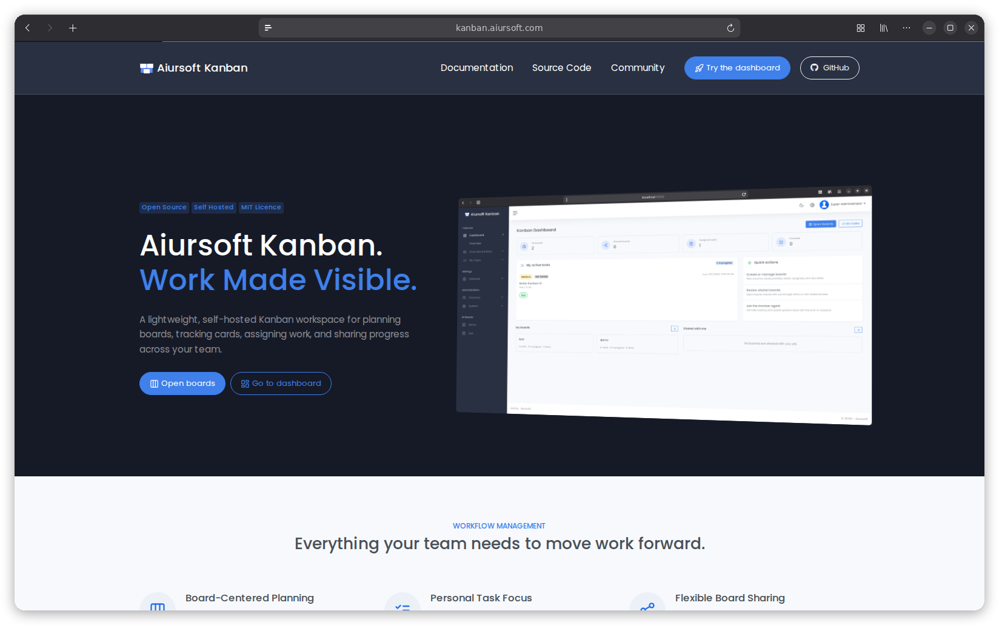

# Aiursoft Kanban

<a name="kanban"></a>

[](https://github.com/aiursoftweb/kanban/blob/master/LICENSE)
[](https://gitlab.aiursoft.com/aiursoft/kanban/-/pipelines)
[](https://gitlab.aiursoft.com/aiursoft/kanban/-/pipelines)
[](https://s360.aiursoft.com/SupplyChain?tab=projects&project=aiursoft%2Fkanban&scope=baseline&ecosystem=all)
[](https://manhours.aiursoft.com/r/github.com/aiursoftweb/kanban.html)
[](https://kanban.aiursoft.com)
[](https://hub.docker.com/r/aiursoft/kanban)

Aiursoft Kanban is a self-hosted project management and workflow planning system built on ASP.NET Core (.NET 10). It helps teams organize boards, columns, cards, labels, priorities, assignees, due dates, comments, and shared access in one lightweight web application.



Default user name is `admin@default.com` and default password is `Admin@123456!`.

## Overview

### What is Kanban?

<a name="why-kanban-for-your-organization"></a>

Kanban provides a practical workspace for teams that need transparent task flow without adopting a heavyweight project management suite. It is designed for self-hosting, fast deployment, and clear ownership of your workflow data.

Key features include:

**Board-Centered Planning.** Create boards with ordered columns, move cards across workflow states, and keep project work visible from planning to completion.

**Task Ownership and Priorities.** Assign cards to users, set priorities and due dates, track overdue work, and use the dashboard to focus on active responsibilities.

**Flexible Sharing.** Share boards with specific users or roles, choose read-only or editable access, and keep private boards isolated from unrelated teams.

**Team-Ready Collaboration.** Use labels, comments, card descriptions, public board links, and the built-in Kanban assistant to coordinate work across a team.

**Self-Hosted Infrastructure.** Run with SQLite for small deployments, MySQL for production scale, or in-memory storage for tests while keeping authentication, RBAC, localization, Docker deployment, and system management in the same application.

## CLI & SDK

### CLI

Install the CLI with the [.NET 10 SDK](https://dotnet.microsoft.com/download/dotnet/10.0):

```bash
dotnet tool install --global Aiursoft.Kanban.Client
```

Update an existing installation:

```bash
dotnet tool update --global Aiursoft.Kanban.Client
```

Remove the CLI:

```bash
dotnet tool uninstall --global Aiursoft.Kanban.Client
```

Run `kanban --help` to explore commands.

See [CLI usage](https://github.com/aiursoftweb/kanban/blob/master/docs/cli.md) for authentication and examples.

### SDK

The [SDK source](https://github.com/aiursoftweb/kanban/tree/master/src/Aiursoft.Kanban.SDK) is included in this repository; it is not published as a separate NuGet package.

### Android app

An optional native .NET Android client is available. See [Android app and OIDC deployment](https://github.com/aiursoftweb/kanban/blob/master/docs/android.md) for identity-provider registration, server settings, APK building, and sideloading.

## Try

Try a running Kanban [here](https://kanban.aiursoft.com).

## Install with Docker

Run the installer with the desired port (omit it to choose an available port):

```bash
curl -fsSL https://raw.githubusercontent.com/aiursoftweb/kanban/master/install.sh | sudo bash -s -- 8080
```

Installation starts after three seconds; press Ctrl+C to cancel. Then open `http://localhost:8080`.

## Run manually

Requirements about how to run

1. Install [.NET 10 SDK](https://dotnet.microsoft.com/download/dotnet/10.0) and [Node.js](https://nodejs.org/).
2. Execute `npm ci --prefix src/Aiursoft.Kanban/wwwroot` and `npm run build --prefix src/Aiursoft.Kanban/wwwroot` from the repository root to prepare the frontend assets.
3. Execute `dotnet run --project src/Aiursoft.Kanban/Aiursoft.Kanban.csproj -- --urls http://localhost:5000` to run the app.
4. Use your browser to view [http://localhost:5000](http://localhost:5000).

## Run in Microsoft Visual Studio

1. Prepare the frontend assets as described above.
2. Open `Aiursoft.Kanban.sln`, select `Aiursoft.Kanban` as the startup project, and press `F5`.

## Run in Docker

First, install Docker [here](https://docs.docker.com/get-docker/).

Then run the following commands in a Linux shell:

```bash
image=aiursoft/kanban
appName=kanban
sudo docker pull $image
sudo docker run -d --name $appName --restart unless-stopped -p 5000:5000 --mount type=volume,source=$appName-data,target=/data $image
```

That will start a web server at `http://localhost:5000` and you can test the app.

The docker image has the following context:

| Properties  | Value                           |
|-------------|---------------------------------|
| Image       | aiursoft/kanban               |
| Ports       | 5000                            |
| Binary path | /app                            |
| Data path   | /data                           |
| Config path | /data/appsettings.json          |

Keep `/data` persistent for configuration, the SQLite database, uploaded files and Data Protection keys. To use a host directory instead of the named volume, replace the mount argument with `-v /var/www/$appName:/data`.

## Usage

Create a board, add ordered columns and cards, and assign work to users. Configure sharing for users and roles; use labels, priorities, due dates and comments to coordinate work. The CLI provides the same board and card operations described in [CLI usage](https://github.com/aiursoftweb/kanban/blob/master/docs/cli.md).

## Configuration

<a name="configuration-guide"></a>

The defaults run as a standalone application with SQLite, local accounts, local file storage, and no ClickHouse server. Change a setting only after preparing the dependency named in its comment.

The Docker image copies this file to `/data/appsettings.json` on its first start and keeps that copy on later starts. Mount `/data` as a persistent volume. To override a value without editing the file, use an environment variable with double underscores, such as `Storage__Path` or `AppSettings__OIDC__ClientSecret`.

```jsonc
{
  "ConnectionStrings": {
    "AllowCache": "True",

    "DbType": "Sqlite",
    "DefaultConnection": "DataSource=app.db;Cache=Shared"

    // sudo docker run -d --name db -e MYSQL_RANDOM_ROOT_PASSWORD=true -e MYSQL_DATABASE=template -e MYSQL_USER=template -e MYSQL_PASSWORD=template_password -p 3306:3306 hub.aiursoft.com/mysql
    //"DbType": "MySql",
    //"DefaultConnection": "Server=localhost;Database=template;Uid=template;Pwd=template_password;"
  },
  "Storage": {
    "Path": "/tmp/data",
    "PublicOrigin": "",
    "RequireDedicatedInlineOrigin": false,
    "AllowArbitraryInlineOnDedicatedOrigin": false,
    "SafeInlineMediaExtensions": ["svg"],
    "SafeInlineSvgSubfolders": ["project-logo"],
    "UploadPolicy": {
      "RequireAuthenticatedUser": false,
      "ReplaceSpacesWithHyphens": false
    }
  },
  "AppSettings": {
    "AuthProvider": "Local", // OIDC or Local
    "DefaultRole": "",
    "PersistsSignIn": false,
    "OIDC": {
      // https://auth.aiursoft.com/application/o/template
      "Authority": "https://auth.aiursoft.com/application/o/template",
      "MobileAuthority": "https://auth.aiursoft.com/application/o/kanban-android",
      "RequireHttpsMetadata": true,
      "ClientId": "",
      "ClientSecret": "",
      "MobileClientId": "kanban-android",
      "ApiAudience": "kanban-android",
      "ApiScope": "",
      "MobileRedirectUri": "com.aiursoft.kanban:/oauth2redirect",
      "RolePropertyName": "groups",
      "UsernamePropertyName": "preferred_username",
      "UserDisplayNamePropertyName": "name",
      "EmailPropertyName": "email",
      "UserIdentityPropertyName": "sub"
    },
    "Local": {
      "AllowRegister": true,
      "AllowWeakPassword": true
    },
    "MarkItDown": {
      "Endpoint": "http://markitdown:8000/api/convert"
    }
  },
  "GlobalSettings": {
    // You can initialize or override global settings here.
    // "Allow_User_Adjust_Nickname": "True",
    // "BrandName": "Aiursoft",
    // "BrandHomeUrl": "https://www.aiursoft.com/",
    // "Icp": "",
    // "ProjectName": "Aiursoft Template"
  },
  "Logging": {
    "LogLevel": {
      "Default": "Information",
      "Microsoft.AspNetCore": "Warning"
    },
    "Clickhouse": {
      "Enabled": false,
      "ConnectionString": "Host=localhost;Protocol=http;Port=8123;User=default;Password=;Database=AspNetCoreLogs",
      "TableName": "TemplateLogs"
    }
  },
  "AuditLogs": {
    "Clickhouse": {
      "Enabled": false,
      "ConnectionString": "Host=localhost;Protocol=http;Port=8123;User=default;Password=;Database=KanbanAudit",
      "TableName": "KanbanAuditLogs"
    }
  },
  "AllowedHosts": "*"
}
```

### Shared settings

- `ConnectionStrings:AllowCache` caches EF Core query results in-process. Choose `Sqlite` for a local file or `MySql` for a prepared external database; change `DefaultConnection` with the provider. Migrations are applied at startup.
- `Storage:Path` is writable local file storage for Workspace and Vault. `PublicOrigin` is an optional second hostname routed to this same application's downloads, not an object-storage endpoint. Dedicated inline viewing requires its own DNS, TLS and reverse-proxy route; arbitrary inline content must use a cookie-free dedicated origin. Media/SVG allowlists constrain inline rendering, not upload permission. Upload token policy changes apply to newly issued tokens.
- `AppSettings:AuthProvider` selects `Local` accounts or `OIDC`. OIDC requires a reachable authority, client settings and the HTTPS `/signin-oidc` callback. Configure role, username, display-name, email and immutable `sub` claims; synchronized OIDC roles and `DefaultRole` govern local membership. `PersistsSignIn` controls persistent cookies. Local registration and password requirements follow `AppSettings:Local`.
- Uncommented `GlobalSettings` values override the database-backed administration UI; commented entries leave its values or built-in defaults in use.
- `Logging:LogLevel` controls application/framework verbosity. `Logging:Clickhouse` is optional application-log export and requires a prepared reachable database when enabled.
- `AllowedHosts` is the ASP.NET Core Host-header allowlist, not CORS. Use the intended public hostnames for a deployment.

Mobile OIDC settings configure the Android client separately from web sign-in; follow [Android app and OIDC setup](https://github.com/aiursoftweb/kanban/blob/master/docs/android.md). `AppSettings:MarkItDown:Endpoint` selects the document-conversion service. `AuditLogs:Clickhouse` controls structured Kanban audit archival separately from ordinary application logs.

## Documentation

- [CLI authentication and usage](https://github.com/aiursoftweb/kanban/blob/master/docs/cli.md)
- [Android app and OIDC setup](https://github.com/aiursoftweb/kanban/blob/master/docs/android.md)

## How to contribute

There are many ways to contribute to the project: logging bugs, submitting pull requests, reporting issues, and creating suggestions.

Even if you have push rights on the repository, you should create a personal fork and create feature branches there when you need them. This keeps the main repository clean and your workflow cruft out of sight.

We're also interested in your feedback on the future of this project. You can submit a suggestion or feature request through the issue tracker. To make this process more effective, we're asking that these include more information to help define them more clearly.

## License

Licensed under the [MIT License](https://github.com/aiursoftweb/kanban/blob/master/LICENSE).
